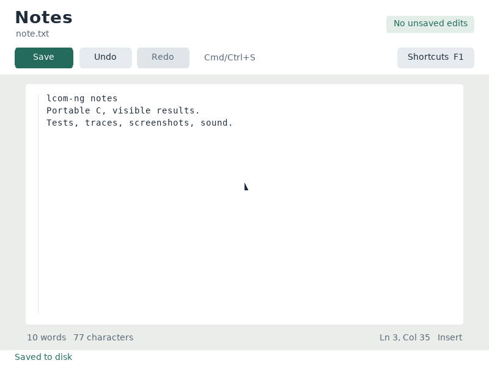
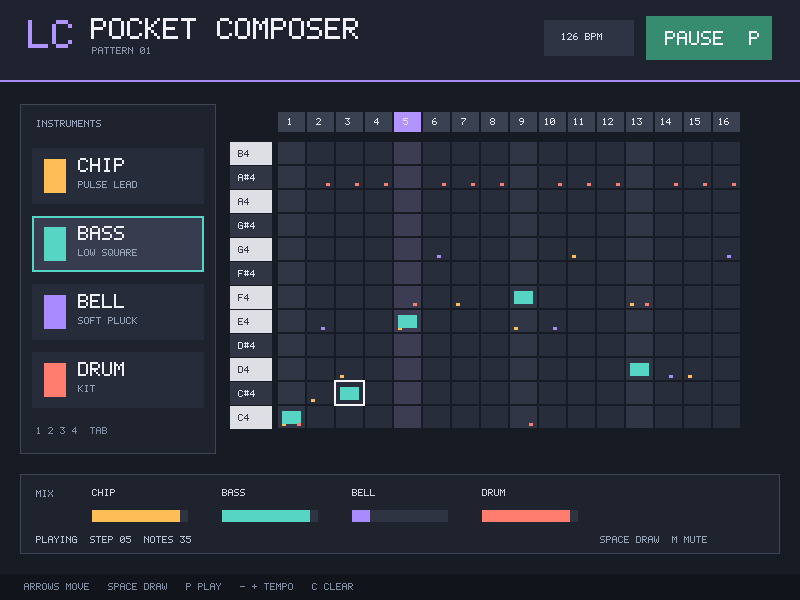
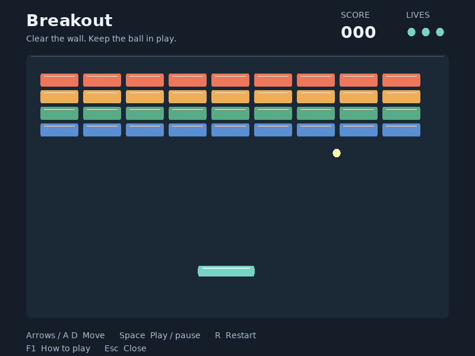

# lcom-ng

Run LCOM labs and C projects on your own computer, without a Minix VM.

[Download](https://github.com/rodrgds/lcom-ng/releases) · [Install guide](https://lcom.rgo.pt/students/install) · [Documentation](https://lcom.rgo.pt/)

## Quick start

Download the archive for your operating system and processor from **GitHub Releases**, extract it, and add its `bin/` directory to your `PATH`. Keep the whole folder, it includes the SDK and desktop libraries. You need a C compiler and Python 3 to build existing projects, plus `make` for native workspaces. See the [install guide](docs-site/students/install.md) for each platform.

### Existing Minix / LCOM project

In the directory containing your original `Makefile`:

```sh
lcom-ng compat build .
lcom-ng run -- .lcom-ng/proj
```

Use the binary path printed by the build command. Its name comes from `PROG` in your Makefile. Your C files, includes and Makefile stay unchanged. Keep the complete project tree, including assets and sibling lab libraries. Build again after edits.

Original labs work the same way, with their usual LCF arguments:

```sh
cd labs/lab2
lcom-ng compat build .
lcom-ng run -- .lcom-ng/lab2 timer_test_int 2
```

[Compatibility guide](docs/from-minix.md) · [Tested projects and known failures](docs/compatibility-recent.md)

### Browser games

Source builds can export a game as static HTML, JavaScript, WebAssembly and
assets, including a touch keyboard for mobile players:

```sh
devenv shell -- lcom-ng web path/to/my-game
```

Use `lcom-ng web .` for your own project. To publish static files, use
`lcom-ng export web . --output dist/game`. See the [browser guide](docs-site/students/browser.md)
for project layouts, hosting and current limits. Earlier release archives do not
include this command.

### Native lcom-ng project

Start a workspace using the native SDK and course labs:

```sh
lcom-ng setup student
cd student
make
lcom-ng run -- build/student_project
lcom-ng test rtc
```

Edit `proj/` for your application and `labs/` for exercises. Fresh lab checks fail until you implement the TODOs. The native API uses `lcom_init` and `lcom_event_wait`; it is the path for new work without Minix service and IPC conventions. Further API simplification can build on this route.

[Native student guide](docs/student-guide.md) · [Lab guides](https://lcom.rgo.pt/labs/)

## See it running

<p>
  
  
</p>
<p>
  
  
</p>

[Watch the demo](docs/assets/demo/machine-lab-demo.mp4) · [More examples](examples/README.md)

## What it supports

| Area | Devices and workflow |
| --- | --- |
| Labs | RTC, timer, keyboard, mouse, graphics, audio and UART |
| Projects | Games, editors, sequencers and paired serial programs |
| Interactive use | SDL display, keyboard, mouse and audio |
| Automated checks | Headless runs, input replay, traces and captured frames |
| Existing course code | Separate Minix/LCF compatibility SDK and Makefile importer |

Compatibility is checked against pinned student projects and original lab code. See the [results](docs/compatibility-results.md), [expanded corpus](docs/compatibility-expanded.md) and [course audit](docs/course-compatibility-audit.md) for exact coverage and limitations. This runtime models the course devices; it does not emulate the Minix operating system.

The CLI is `lcom-ng`. Existing `lcom`, `machinelab`, `lowlab` and `mlab` aliases remain supported, along with the public `<lcom/...>` headers.

## For instructors and developers

[Adoption guide](docs/adoption.md) · [Instructor guide](docs/instructor-guide.md) · [Contributing](CONTRIBUTING.md) · [Release workflow](docs-site/developers/releases.md)

To build lcom-ng itself:

```sh
devenv shell -- lcom-ng-install
devenv shell -- lcom-ng-verify
```

The [developer guide](docs/developer-guide.md) covers source builds and repository structure. Students using a release archive do not need Devenv or this checkout.

## License

Code: [MIT](LICENSE). Course material, docs and media: [CC BY 4.0](course/LICENSE.md).
