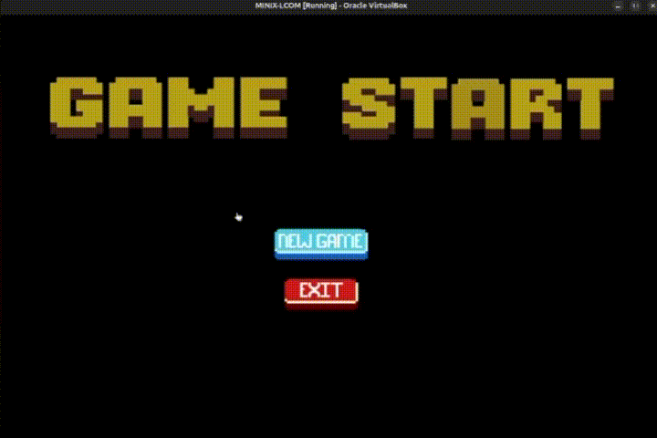
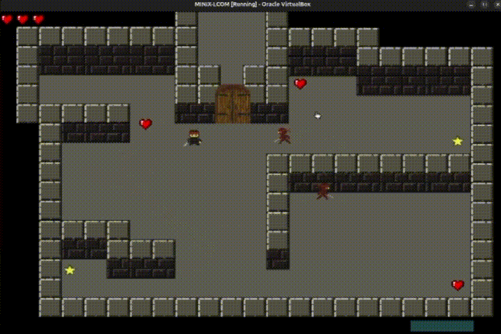
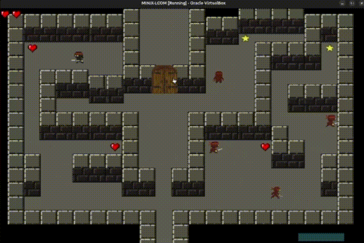
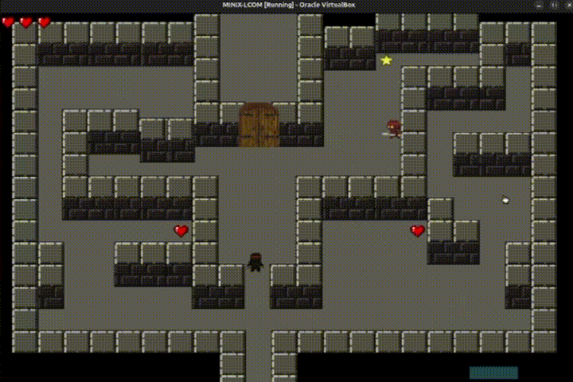
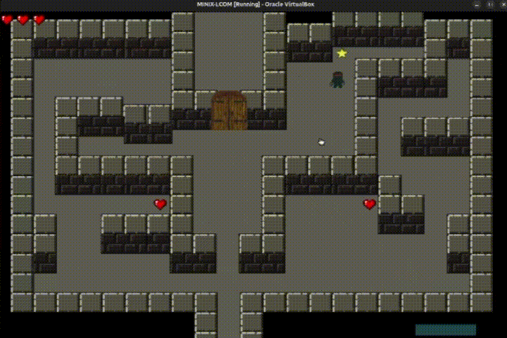
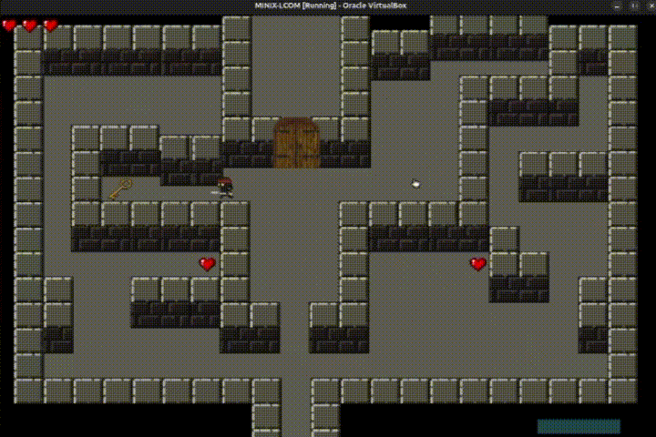
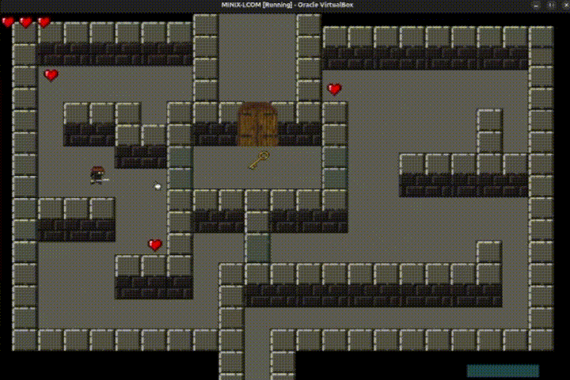
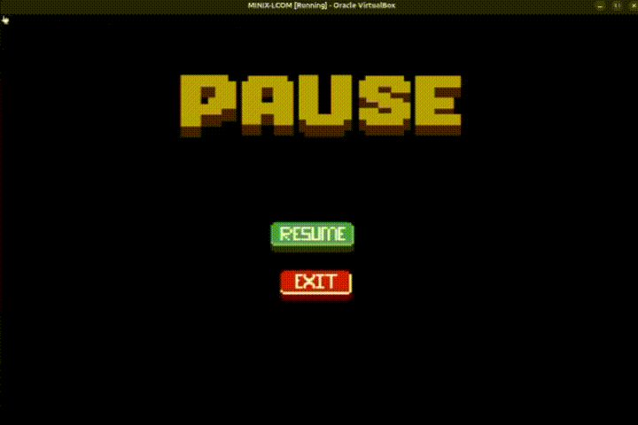
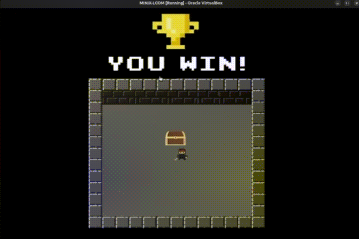

# Labyrinth Game (MINIX 3)

A low-level 2D action-adventure labyrinth game developed in C for the MINIX 3 operating system. This project was created for the Computer Laboratory course (LCOM) at the Faculty of Engineering of the University of Porto (FEUP).

The application interfaces directly with hardware peripherals—including the graphics card, programmable interval timer, keyboard, and PS/2 mouse—to build a real-time event-driven game without relying on high-level operating system UI libraries.

---

## Technical Overview

### Low-Level Architecture & Hardware Drivers

- **Graphics Subsystem (VBE 0x115)**
  - Configures VESA BIOS Extension (VBE) mode `0x115` providing an 800x600 resolution display in 24-bit Direct Color (8:8:8 RGB format).
  - Maps physical Video RAM (VRAM) directly into process memory space using kernel primitives (`vm_map_phys` and `sys_privctl`).
  - Implements off-screen double buffering in RAM to eliminate visual tearing and flickering during frame updates (`buffer_flip`).
  - Custom pixel renderer supporting chroma-key transparency (`0xFF000000`) and sprite mirroring/flipping on the horizontal axis.

- **Keyboard Controller (i8042 KBC)**
  - Subscribes to hardware IRQ 1 asynchronously.
  - Custom interrupt handler (`kbc_ih`) reads raw scancodes from port `0x60` with full status register verification (port `0x64`).
  - Processes two-byte scancodes and tracks multi-key inputs for smooth 8-directional WASD movement and active skill triggers.

- **PS/2 Mouse Controller (i8042 Auxiliary)**
  - Subscribes to hardware IRQ 12 and issues command sequences (`0xD4` / `0xF4`) to enable streaming packet data reporting.
  - Reconstructs 3-byte mouse packets into relative displacements ($\Delta X$, $\Delta Y$) with 9-bit two's complement sign extension and overflow protection.
  - Calculates real-time angular orientation between the cursor and player sprite for 360-degree aiming and blade targeting.
  - Handles edge-triggered left and right mouse button clicks for weapon attacks and environmental interactions.

- **Programmable Interval Timer (i8254 PIT)**
  - Subscribes to hardware IRQ 0 and reconfigures Timer 0 to a fixed operating frequency of 20 Hz.
  - Serves as the primary clock generator for game physics, animation cycles, state logic transitions, and frame synchronization.

- **Event Loop & IPC Handling**
  - Driven by MINIX 3 Inter-Process Communication (`driver_receive`).
  - Main loop asynchronously receives interrupt notifications from hardware endpoints and dispatches handling functions based on an internal finite-state machine.

---

## Gameplay & Features

### Core Mechanics

- **Level Exploration & Progression**: The game spans 3 distinct levels with increasing difficulty. Players navigate through room layouts containing obstacles, hidden traps, and patrolling enemies.
- **Star & Key System**: To unlock the exit door of each level, players must collect all stars scattered across the map. Gathering the final star spawns a key required to unlock the door to the next stage.
- **Combat & Aiming**: The player can aim 360 degrees using the mouse cursor and launch blade projectiles with right-click to eliminate patrolling monsters.
- **Speed Dash Ability**: Holding the Spacebar consumes stamina to grant a temporary speed boost. In Level 3, this extra velocity is required to break through reinforced walls.
- **Health & Trap Mechanics**: Players start with 3 lives. Colliding with monsters or stepping on hidden landmine bombs causes damage. Health can be restored by collecting hearts found throughout the levels.

---

## Controls

| Input | Action |
| --- | --- |
| **W / A / S / D** | Player Movement (Up, Left, Down, Right) |
| **Spacebar** | Activate Speed Dash |
| **Mouse Movement** | Aim Cursor / Player Facing Direction |
| **Right Mouse Click** | Throw Blade Weapon |
| **Left Mouse Click** | Interact with Doors, Chests, and Menu Buttons |

---

## Visual Showcase

### Game Start Menu
Main entry interface providing options to begin the game or exit.



---

### Combat & Weapon Aiming
Precision aiming towards enemies using the cursor, firing blade projectiles with the right mouse button.



---

### Lives & Recovery System
Player health meter showing heart loss on enemy/trap collision and health recovery via collectible hearts.



---

### Hidden Traps & Bomb Explosions
Concealed landmines that detonate when triggered by player proximity.



---

### Level Progression (Stars, Key & Door)
Collecting all level stars spawns the key, allowing the player to interact with the exit door and advance.

  


---

### Speed Ability & Special Barriers
Using the speed dash ability (Spacebar) to pass through dash-sensitive walls in Level 3.



---

### Pause Menu
In-game menu system for pausing, resuming, or quitting the active session.



---

### Victory Screen
Completion interface rendered upon clearing all three levels.



---

## Technologies Used

- **Programming Language**: C (C11 standard)
- **Target OS**: MINIX 3 (x86 Microkernel Architecture)
- **Graphics Standard**: VESA BIOS Extension (VBE 2.0+ Mode `0x115` - 800x600 24-bit Direct Color)
- **Hardware Architecture**:
  - i8042 Keyboard & Mouse Controller (KBC)
  - i8254 Programmable Interval Timer (PIT)
- **Libraries**: MINIX `liblcf` (LCOM Framework), `libxpm` (XPM Pixmap Parser), `liblm` (Low Memory Manager)
- **Build System**: GNU Make / MINIX BSD Make

---

## Project Structure

```text
lc-proj/
├── proj/
│   ├── doc/                 # Doxygen documentation setup
│   └── src/
│       ├── drivers/         # Low-level hardware drivers
│       │   ├── keyboard.c/h # i8042 KBC keyboard interrupt handling
│       │   ├── mouse.c/h    # i8042 KBC PS/2 mouse packet decoding & state
│       │   ├── timer.c/h    # i8254 PIT frequency setup & tick counters
│       │   └── video.c/h    # VBE 0x115 graphics mapping & double buffering
│       ├── helper/
│       │   ├── i8042.h      # KBC port definitions and command constants
│       │   ├── i8254.h      # PIT timer port definitions and control words
│       │   ├── structs.h    # Sprite, mouse packet, and input state definitions
│       │   └── utils.c      # System input/output wrapper functions
│       ├── states/
│       │   ├── game.c/h     # Core game loop, level logic, AI, collision
│       │   └── menu.c/h     # Main, pause, and victory menu state logic
│       ├── xpm/             # Game assets (sprites, backgrounds, UI elements)
│       ├── main.c           # Entry point & MINIX IPC notification loop
│       └── Makefile         # Compilation directives and library dependencies
├── video+gifs/              # Project demonstration media assets
└── README.md                # Project documentation
```

---

## Building & Running

### Requirements

To compile and run this project, you need a **MINIX 3** operating system environment (either running natively or inside a virtual machine such as VirtualBox or QEMU).

### Compilation

1. Navigate to the source directory inside MINIX 3:
   ```bash
   cd proj/src
   ```

2. Compile the executable using `make`:
   ```bash
   make
   ```

### Execution

Because the program directly accesses hardware I/O ports and maps physical memory, it must be executed with root/privileged driver permissions provided by LCOM's execution framework:

```bash
lcom_run proj
```

To clean up object files and compilation artifacts:

```bash
make clean
```

---

## Asset References & Attribution

- **Treasure Chest (`reward.xpm`)**  
  Created by UndineH6  
  Licensed under [CC0 1.0 Universal (Public Domain Dedication)](https://creativecommons.org/publicdomain/zero/1.0/)  
  Source: [OpenGameArt - Chest #5](https://opengameart.org/content/chest-5)

- **Castle Door (`door.xpm`)**  
  Created by Tuomo Untinen  
  Licensed under [Creative Commons Attribution 3.0 (CC BY 3.0)](https://creativecommons.org/licenses/by/3.0/)  
  Source: [OpenGameArt - Castle Door](https://opengameart.org/content/castle-door)

- **Explosion Animation (`explosion1-6.xpm`)**  
  Created by Sogomn  
  Licensed under [CC0 1.0 Universal (Public Domain Dedication)](https://creativecommons.org/publicdomain/zero/1.0/)  
  Source: [OpenGameArt - Explosion #3](https://opengameart.org/content/explosion-3)

- **Heart Icon (`heart.xpm`)**  
  Created by Flixberry Entertainment  
  Licensed under [CC BY 3.0](https://creativecommons.org/licenses/by/3.0/) / [CC BY 4.0](https://creativecommons.org/licenses/by/4.0/)  
  Source: [OpenGameArt - Heart Pixel Art](https://opengameart.org/content/heart-pixel-art)

- **Key Icons (`key.xpm`)**  
  Created by BlizmasterStudios  
  Licensed under [Creative Commons Attribution 4.0 (CC BY 4.0)](https://creativecommons.org/licenses/by/4.0/)  
  Source: [OpenGameArt - Key Icons](https://opengameart.org/content/key-icons)

- **Ninja Character (`knife.xpm`)**  
  Created by DezrasDragons  
  Licensed under [CC0 1.0 Universal (Public Domain Dedication)](https://creativecommons.org/publicdomain/zero/1.0/)  
  Source: [OpenGameArt - Ninja Animated](https://opengameart.org/content/ninja-animated)

- **Ninja / Monster Sprites (`ninja-*.xpm`, `monster-*.xpm`, `ninja-speed-*.xpm`)**  
  Generated with [Sora by OpenAI](https://openai.com/sora)  
  Usage permitted under [OpenAI Terms of Use](https://openai.com/policies/terms-of-use)

---

## Authors

Developed for the Computer Laboratory course (LCOM 2023/2024) at FEUP:

- Catarina Bastos ([up202307631@up.pt](mailto:up202307631@up.pt))
- Filipe Solha ([up202306528@up.pt](mailto:up202306528@up.pt))
- Nuno Costa ([up202305503@up.pt](mailto:up202305503@up.pt))
- Vasco Gonçalves ([up202305513@up.pt](mailto:up202305513@up.pt))
